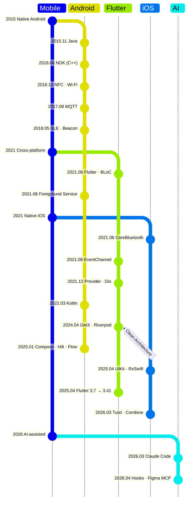

# 👋 Hi, I'm Chiyoung

경기에서 근무하는 **7년차 모바일 엔지니어**입니다.
Flutter · Android 네이티브 · iOS 네이티브로 고객사 및 사내 앱의 출시, 운영 및 유지보수를 담당하고 있습니다.

가장 자신있는 도메인은 **IoT, 통신, 헬스케어**입니다. Android 네이티브로 보편적인 통신 규격을 다뤄왔고, 그 경험을 Flutter와 iOS 네이티브에서도 활용하고 있습니다.

 

## 🛠 Tech Stack

#### Languages
    

#### Mobile
    

#### Architecture & State
      

#### Device & Network
   

#### Backend & Tools
        

 

## 🌱 Tech Stack History

 

## 📫 Contacts

  
  

